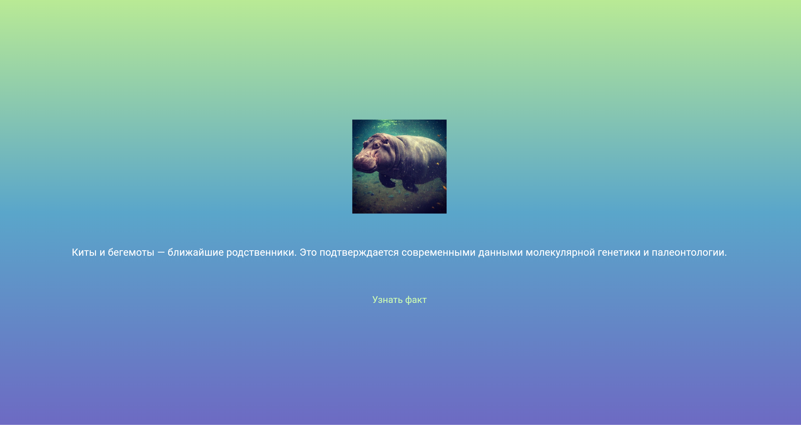

# Лабораторная работа №6. Flutter: самостоятельное приложение

## Описание проекта
Приложение отображает случайные интересные факты о животных, космосе и истории. При нажатии на кнопку приложение генерирует случайный индекс, меняет текстовое содержимое и переключает соответствующее изображение.

## Информация об авторе
**ФИО:** Буничева Алёна Алексеевна

**Группа:** ИСП-242

**Дата сдачи:** 25.10.2026

## Стек и версии
* **Flutter:** 3.47.4
* **Dart:**  3.13.3
* **Платформа:** Web (Chrome)
* **IDE:** VS Code

## Структура проекта
В папке `lib/` реализовано 3 виджет-класса в отдельных файлах:
1. `main.dart` — точка входа в приложение, настраивает MaterialApp и Scaffold.
2. `gradient_container.dart` — кастомный StatelessWidget, формирующий трехцветный фоновый градиент.
3. `fact_roller.dart` — StatefulWidget, содержащий массив данных, логику случайного выбора факта через Random и обновление интерфейса с помощью setState.
4. `fact_text.dart` — кастомный StatelessWidget для стилизации текста.

## Инструкция по запуску
1. Клонировать репозиторий: `git clone https://github.com/youkani/Flutter_Lab5.git`
2. Перейти в корневую папку проекта: `cd my_app_bunicheva`
3. Загрузить зависимости проекта: `flutter pub get`
4. Запустить приложение в браузере: `flutter run -d chrome`

## Что было изучено
- Практика декомпозиции интерфейса, разбив приложение на отдельные файлы и создав 3 собственных виджет-класса.
- Работа с динамическим интерфейсом и обновлять экран в рантайме с помощью функции setState().
- Реализация механизма динамической подгрузки изображений из папки assets/images/ на основе меняющегося индекса списка.
- Закреплены навыки работы с библиотекой dart:math и объектом Random для переключения элементов без повторения строгой последовательности.
- Как делать виджеты гибкими, передавая в них чистые строки (String) и цвета (Color) в качестве параметров.
